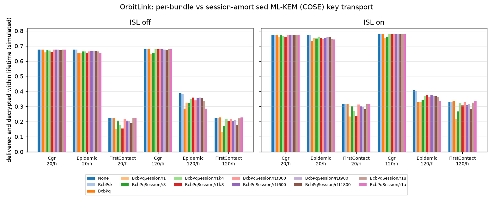

# Amortising Post-Quantum Key Transport in Delay-Tolerant Satellite Networks

*Working draft. Network metrics are SIMULATED and cryptographic CPU times are MEASURED
(`results/20261128T120000Z/`: 1,560 runs = 156 configurations x 10 seeds, 12 h simulated each; its first
1,440 runs are `results/20261126T200000Z/` and the first 1,080 of those `results/20261125T141910Z/`, which the
simulator reproduces exactly per seed). Sections marked
**[TODO]** are not done.*

## Abstract

Bundle Protocol Security is moving to COSE, and ML-KEM is the expected post-quantum key transport there
(draft-ietf-dtn-bpsec-cose-19 with draft-ietf-cose-pqc-kem-00). We implement that encoding: a BCB with security
context 3 carrying a COSE_Encrypt with one ML-KEM-768 recipient. Our AAD construction and AES-256-GCM output
reproduce the draft's Appendix A vector byte for byte, and KMAC256 matches the NIST SP 800-185 samples. Per bundle,
ML-KEM key transport adds 1,184 bytes. With no end-to-end acknowledgements, a sender cannot know when the destination
has learned a key, so amortisation is risky. We measure a simple amortisation: one encapsulation per
(source, destination, hour), with the KEM ciphertext carried only by the first r bundles of the session and a COSE
"direct" recipient in the others. In a simulated 72-satellite LEO DTN it cuts security bytes per bundle from
1,184 to 132-807, and the number of KEM-carrying bundles by 34-96 %. It changes the outcome in opposite directions
depending on routing. Under buffer-bound epidemic routing it **raises** decrypted delivery (0.285 to 0.325,
+14 %, at high load without ISLs). Under contact-graph routing it **lowers** it by up to 0.031 absolute. Under
first-contact (random-walk) routing it lowers it by up to 0.121 absolute: with r = 1 at high load without ISLs, 42 % of
delivered bundles are never decrypted. The less predictable the routing, the less safe amortisation becomes,
because delivered bundles miss every key-carrying bundle of their session before they expire. Re-carrying the
ciphertext once 15 minutes have passed since it was last sent restores per-bundle decryptability under CGR at both
loads (within 0.001) for 22-56 % of the per-bundle bytes. Under first-contact routing, re-carrying it whenever the
source's uplink satellite changes comes within 0.010 of per-bundle decryptability at 38-76 % of the bytes.

## 1. Contribution and novelty status

- **Not novel:** ML-KEM key transport in BPSec, which is the IETF path (bpsec-cose + cose-pqc-kem). We implement and
  measure it.
- **Candidate contribution:** the amortisation/decryptability trade-off of post-quantum key transport in
  acknowledgement-free DTNs, quantified per routing regime, and refresh rules (count-, time- and uplink-based) that
  close it. A literature search (2026-11-22 and 2026-11-27; queries and verdicts in docs/RESEARCH.md) found no
  prior work that reuses one KEM encapsulation across bundles or measures decryptability against DTN routing:
  - closest in topic: Detke et al. (WiSEE 2026) couple CGR route selection with *pre-provisioned symmetric* key
    scopes (no KEM, no key carried in bundles, no decryptability metric); BPKD (Würbs et al., SpaceOps 2025)
    distributes public keys by keystore snapshots and derives long-lived symmetric keys;
  - post-quantum DTN: dos Santos et al. (ECCWS, survey, no simulation) name "a post-quantum key ... may expire
    before reaching its destination" as open; Tanchev (STINT 2026) encapsulates each bundle to receiver epoch keys
    (no reuse across bundles); Kedrowitsch (VT dissertation 2025) runs ML-KEM under intermittent computing and
    builds a BPv7 ns-3 module (no bundle-level key reuse or routing measurement);
  - earlier: the IETF drafts, the DTKA draft, Menesidou et al. (2017 survey), Rüsch et al. (CHANTS 2017,
    per-bundle puncturable encryption), Eichen et al. (arXiv 2607.23007, interactive KDC/PSK handshake) and
    Dowling et al. (arXiv 2503.06785, survey).
  Limits: these were read by question-answering passes over the full texts, not line by line; paywalled venues
  (IEEE Xplore, ACM DL full text) were not searched directly.

## 2. Setup

Constellation, stations and traffic are as in README. Coverage: a 53-degree shell plus a 97.6-degree shell, so every
station has at least 104 passes in 12 h. Variants: None, BcbPsk (RFC 9173, PSK used directly), BcbPq (COSE,
ML-KEM per bundle), and BcbPqSession with r = 1 or 3 (session = one hour). A delivered session bundle counts as
decrypted only if a key-carrying bundle of its session reaches the destination before the bundle's 3 h lifetime
ends. Placeholder codepoints: ML-KEM-768 "TBD2" and `ek` "TBD11 (assumed -4)"; see src/cose.rs.

## 3. Results (mean +/- 95 % CI over 10 seeds; full table in summary.md)

### Bytes

| Variant | Added bytes per bundle (high load / low load) | KEM-carrying bundles (high load) |
|---|---|---|
| BcbPsk | 48 / 48 | 0 |
| BcbPq (COSE, per bundle) | 1,184 / 1,184 | 8,645 of 8,645 |
| BcbPqSession r=1 | 132 / 351 | 360 |
| BcbPqSession r=3 | 223 / 807 | 1,080 |

The COSE encoding costs 39 bytes per bundle more than our earlier ad-hoc stand-in (1,145 bytes).

### Decrypted delivery ratio (delivered and decrypted within lifetime / generated)

| ISL | load | routing | BcbPq | Session r=1 | Session r=3 | BcbPsk |
|---|---|---|---|---|---|---|
| off | 120 | CGR | 0.678 +/- 0.004 | 0.647 +/- 0.005 | 0.653 +/- 0.004 | 0.678 |
| off | 20 | CGR | 0.677 +/- 0.005 | 0.658 +/- 0.007 | 0.674 +/- 0.006 | 0.677 |
| on | 120 | CGR | 0.780 +/- 0.004 | 0.754 +/- 0.005 | 0.760 +/- 0.006 | 0.780 |
| on | 20 | CGR | 0.775 +/- 0.004 | 0.760 +/- 0.004 | 0.773 +/- 0.003 | 0.775 |
| off | 120 | Epidemic | 0.285 +/- 0.004 | 0.325 +/- 0.003 | 0.324 +/- 0.002 | 0.383 |
| off | 20 | Epidemic | 0.654 +/- 0.009 | 0.654 +/- 0.008 | 0.664 +/- 0.007 | 0.677 |
| on | 120 | Epidemic | 0.328 +/- 0.003 | 0.328 +/- 0.006 | 0.343 +/- 0.007 | 0.401 |
| on | 20 | Epidemic | 0.734 +/- 0.007 | 0.753 +/- 0.006 | 0.749 +/- 0.005 | 0.774 |

### Findings

1. **CGR: amortisation costs decryptability, not delivery.** Delivery is identical, but 3-5 % of delivered bundles
   stay undecryptable at high load. r = 3 recovers almost everything at low load (0.773 vs 0.775 with ISLs). At high
   load it barely helps (0.653 vs 0.647): with about 24 bundles per session per hour, the first r bundles are a
   small, time-clustered sample, and when they fail the later bundles cannot recover.
2. **Epidemic: amortisation helps when buffers bind.** Smaller bundles mean fewer refusals. Decrypted delivery rises
   by 0.039-0.040 at high load without ISLs, and the median time to plaintext falls from 8,033 s to 6,468 s. With ISLs
   at high load, r = 1 is not better than per-bundle (0.328 vs 0.328) but r = 3 is (0.343).
3. **Unpredictable routing punishes amortisation most.** Under FirstContact, delivery is unchanged, but decrypted
   delivery at high load drops from 0.227 to 0.130 (r = 1) or 0.173 (r = 3) without ISLs, and from 0.336 to 0.215 or
   0.267 with ISLs. Key-carrying bundles and later bundles take unrelated random paths.
4. **The gap to PSK remains.** Even the best of these PQ variants stays below BcbPsk under epidemic routing at high
   load (0.324-0.343 vs 0.383-0.401).

## 4. Ciphertext refresh: periodic and time-based (results/20261125T141910Z)

Finding 1 suggests carrying the ciphertext *where it will be needed* rather than only first. We tested two simple
rules on top of r = 1: the ciphertext on every k-th bundle of a session (k = 4, 8; `refresh_every`), and the
ciphertext on the first bundle sent once t seconds have passed since it was last carried (t = 900, 1800;
`refresh_s`). The simulator is deterministic per seed, so the section 3 cells are the same runs.

Decrypted delivery ratio (mean over 10 seeds), with added bytes per bundle in the last row (high load / low load):

| ISL | load | routing | BcbPq | r=1 | r=3 | r=1, k=4 | r=1, k=8 | r=1, t=900 s | r=1, t=1800 s | BcbPsk |
|---|---|---|---|---|---|---|---|---|---|---|
| off | 120 | CGR | 0.678 | 0.647 | 0.653 | 0.678 | 0.677 | 0.677 | 0.674 | 0.678 |
| on | 120 | CGR | 0.780 | 0.754 | 0.760 | 0.780 | 0.780 | 0.780 | 0.780 | 0.780 |
| off | 20 | CGR | 0.677 | 0.658 | 0.674 | 0.670 | 0.659 | 0.676 | 0.673 | 0.677 |
| on | 20 | CGR | 0.775 | 0.760 | 0.773 | 0.768 | 0.761 | 0.775 | 0.771 | 0.775 |
| off | 120 | Epidemic | 0.285 | 0.325 | 0.324 | 0.349 | 0.360 | 0.358 | 0.357 | 0.383 |
| on | 120 | Epidemic | 0.328 | 0.328 | 0.343 | 0.370 | 0.373 | 0.371 | 0.367 | 0.401 |
| off | 120 | FirstContact | 0.227 | 0.130 | 0.173 | 0.216 | 0.201 | 0.209 | 0.180 | 0.223 |
| on | 120 | FirstContact | 0.336 | 0.215 | 0.267 | 0.324 | 0.307 | 0.317 | 0.284 | 0.330 |
| off | 20 | FirstContact | 0.223 | 0.151 | 0.207 | 0.178 | 0.153 | 0.205 | 0.190 | 0.223 |
| on | 20 | FirstContact | 0.318 | 0.234 | 0.300 | 0.268 | 0.238 | 0.299 | 0.282 | 0.318 |
| bytes | | | 1,184 / 1,184 | 132 / 351 | 223 / 807 | 378 / 460 | 243 / 357 | 262 / 668 | 177 / 516 | 48 / 48 |

95 % CI half-widths are 0.002-0.007 at high load and up to 0.013 at low load (summary.md).

5. **At high load, periodic refresh closes the CGR gap.** k = 8 matches per-bundle BcbPq (0.677 vs 0.678; 0.780)
   at 21 % of its bytes (243 vs 1,184), and beats r = 3 on both decryptability and bytes. Refreshing spreads
   key-carrying bundles over the epoch, so one failed early burst no longer strands the rest of the session.
6. **At low load, a count-based rule rarely fires.** Sessions hold only a few bundles per hour, so k = 8 is almost
   r = 1 (362 vs 354 key-carrying bundles) and k = 4 sits between r = 1 and r = 3.
7. **A time-based rule works at both loads under CGR.** t = 900 s is within 0.001 of per-bundle BcbPq in all four
   CGR cells, at 22 % of its bytes at high load and 56 % at low load. At low load it matches or beats r = 3
   (0.676 vs 0.674; 0.775 vs 0.773) with 17 % fewer bytes (668 vs 807). The number of refreshes depends on elapsed
   time rather than on how many bundles a session holds, which fixes the weakness in finding 6. t = 1800 s is
   cheaper (177 / 516 bytes) and stays within 0.004 of per-bundle under CGR.
8. **Under epidemic routing at high load, refresh is the best PQ variant.** k = 8 (0.360 / 0.373) and t = 900 s
   (0.358 / 0.371) are tied within the CIs, narrowing the gap to BcbPsk to 0.02-0.03 (from 0.06-0.07 for r = 1).
9. **Under FirstContact, no single rule wins.** At high load k = 4 recovers the most (0.216 of 0.227, 0.324 of
   0.336, at 32 % of per-bundle bytes), with t = 900 s close behind. At low load, t = 900 s and r = 3 are tied
   (0.205 vs 0.207, 0.299 vs 0.300), with t = 900 s using fewer bytes; k = 4 and k = 8 fall behind because they
   rarely fire.

Overall, t = 900 s is the only setting of this group that stays near the best variant in every routing regime and
load.

### Shorter intervals and uplink-change refresh

Two more rules, same runs and seeds: t = 300 s and t = 600 s, and an uplink rule (r1u) that carries the
ciphertext again whenever the satellite the source will upload to changes. That satellite is the first contact from
the source that is open at or after the bundle's creation; it approximates the first hop, which the simulator does
not decide at creation time. Decrypted delivery ratio (mean +/- 95 % CI half-width, 10 seeds):

| ISL | load | routing | BcbPq | r=1, k=4 | t = 300 s | t = 600 s | t = 900 s | uplink (r1u) | BcbPsk |
|---|---|---|---|---|---|---|---|---|---|
| off | 120 | FirstContact | 0.227 +/- 0.003 | 0.216 | 0.220 | 0.203 | 0.209 | 0.221 +/- 0.003 | 0.223 |
| on | 120 | FirstContact | 0.336 +/- 0.004 | 0.324 | 0.328 | 0.310 | 0.317 | 0.326 +/- 0.004 | 0.330 |
| off | 20 | FirstContact | 0.223 +/- 0.007 | 0.178 | 0.218 | 0.206 | 0.205 | 0.223 +/- 0.007 | 0.223 |
| on | 20 | FirstContact | 0.318 +/- 0.011 | 0.268 | 0.313 | 0.301 | 0.299 | 0.316 +/- 0.011 | 0.318 |
| off | 120 | Epidemic | 0.285 | 0.349 | 0.341 | 0.354 | 0.358 | 0.339 | 0.383 |
| on | 120 | Epidemic | 0.328 | 0.370 | 0.364 | 0.373 | 0.371 | 0.363 | 0.401 |
| bytes | | | 1,184 / 1,184 | 378 / 460 | 462 / 918 | 320 / 764 | 262 / 668 | 449 / 901 | 48 / 48 |

Under CGR every rule in this table except k = 4 at low load (0.670 vs 0.677) is within 0.001 of per-bundle BcbPq
(summary.md).

10. **Under FirstContact, uplink-change refresh closes the gap at both loads.** r1u is within 0.000-0.010 of
    per-bundle BcbPq in all four FirstContact cells (0.221 vs 0.227, 0.326 vs 0.336, 0.223 vs 0.223, 0.316 vs
    0.318), where the best earlier rules left 0.011-0.012 (k = 4 at high load) or 0.018-0.019 (t = 900 s at low
    load). It costs 38 % of per-bundle bytes at high load and 76 % at low load, because a ground station's uplink
    satellite changes many times per hour.
11. **Most of that gain comes from refreshing often.** t = 300 s is within 0.001-0.005 of r1u in every
    FirstContact cell, at about the same bytes (462 / 918 vs 449 / 901). Knowing the uplink adds little over a
    short timer in this constellation, and a timer needs no contact plan.
12. **Under epidemic routing, frequent refresh hurts.** Larger bundles cost buffer space: at high load r1u and
    t = 300 s (0.339-0.364) fall below t = 600-900 s (0.354-0.373).

So the refresh rule should follow the routing regime: t = 600-900 s for CGR and epidemic routing, and t = 300 s or
uplink-change refresh for first-contact routing. Not yet tested: refresh on the actual first hop (needs per-bundle
routing decisions at the source).

### Destination key acknowledgements

The obvious alternative to blind refresh is feedback: when the destination first learns a session key it returns a
key-ack bundle (16-byte payload) to the source through the same DTN, and the source carries the ciphertext on every
bundle of the session until the ack arrives (variant r1a). The ack is routed like data, so its delay and loss are
simulated, and its bytes are counted (ack bytes per data bundle).

| ISL | load | routing | BcbPq: decrypted / bytes | acks (r1a): decrypted / bytes + ack bytes | best refresh: decrypted / bytes |
|---|---|---|---|---|---|
| off | 120 | CGR | 0.678 / 1,184 | 0.678 / 1,158 + 223 | t900: 0.677 / 262 |
| on | 120 | CGR | 0.780 / 1,184 | 0.780 / 715 + 293 | t900: 0.780 / 262 |
| off | 20 | CGR | 0.677 / 1,184 | 0.677 / 1,166 + 212 | t900: 0.676 / 668 |
| off | 120 | Epidemic | 0.285 / 1,184 | 0.287 / 1,177 + 44 | t900: 0.358 / 262 |
| on | 120 | Epidemic | 0.328 / 1,184 | 0.333 / 1,149 + 55 | t600: 0.373 / 320 |
| off | 120 | FirstContact | 0.227 / 1,184 | 0.227 / 1,175 + 62 | r1u: 0.221 / 449 |
| on | 120 | FirstContact | 0.336 / 1,184 | 0.335 / 1,007 + 129 | r1u: 0.326 / 449 |
| off | 20 | FirstContact | 0.223 / 1,184 | 0.223 / 1,181 + 41 | r1u: 0.223 / 901 |

13. **Key acks restore decryptability but save almost no bytes.** r1a matches per-bundle BcbPq in every cell
    (within 0.005), but its security bytes per bundle stay at 1,007-1,181 without ISLs (715-1,181 overall) even
    before counting the acks, and with the acks the total exceeds per-bundle in 8 of the 12 cells (e.g. 1,381 vs
    1,184 for CGR at high load without ISLs). The ack returns only after a DTN round trip, by which time most of
    the one-hour session has already been sent with the ciphertext. Savings appear only with ISLs, where round
    trips are short (totals 1,008-1,180, best for CGR at high load: 1,008 vs 1,184), and stay far above the
    refresh rules (262-449 bytes at high load).
14. **Under epidemic routing, acks undo the amortisation gain.** Bundles are as large as per-bundle ones again, so
    decrypted delivery falls back to the per-bundle level (0.287 vs 0.285), below every refresh rule (0.358 for
    t = 900 s).

So feedback-based key management does not pay at DTN round-trip times; open-loop refresh dominates it on bytes at
equal or nearly equal decryptability. Acks could pay with sessions much longer than the round trip (an
untested regime here, where the session is one hour).

*Figure 1. Bundles delivered and decrypted within their lifetime, over bundles generated (simulated; mean over 10
seeds). Under CGR every refresh rule reaches the per-bundle BcbPq bar at high load, and t = 300-900 s and r1u also
at low load; r1 and r3 stay below it at 120/h. Under FirstContact, r1u and r1t300 come closest to BcbPq.*

## 5. Security trade-off

A session key protects up to one hour of bundles between a pair: compromising it exposes that epoch, whereas
per-bundle keys bound exposure to one bundle. The receiver caches a session key only after it authenticated a
bundle, so a forged KEM ciphertext cannot poison the cache (test `forged_kem_bundle_does_not_poison_session_cache`).
There is still no sender authentication (ML-DSA via the COSE context is future work).

## 6. Limitations

Simplified orbits; no inter-shell links; static rates; CGR without volume accounting; 10 seeds; one session length
(1 h); single network-wide PSK; placeholder COSE codepoints; the PartyU/V KDF detail differs between the two drafts.

## References (verified; see docs/RESEARCH.md)

RFC 9171, RFC 9172, RFC 9173; draft-ietf-dtn-bpsec-cose-19; draft-ietf-cose-pqc-kem-00; draft-ietf-cose-hpke-27;
NIST SP 800-38D; NIST SP 800-185 KMAC samples; FIPS 203; S. Rüsch et al., *Forward Secure Delay-Tolerant
Networking*, CHANTS 2017, doi:10.1145/3124087.3124094; S. A. Menesidou et al., *Cryptographic Key Management in
Delay Tolerant Networks: A Survey*, Future Internet 2017; draft-burleigh-dtnwg-dtka.
